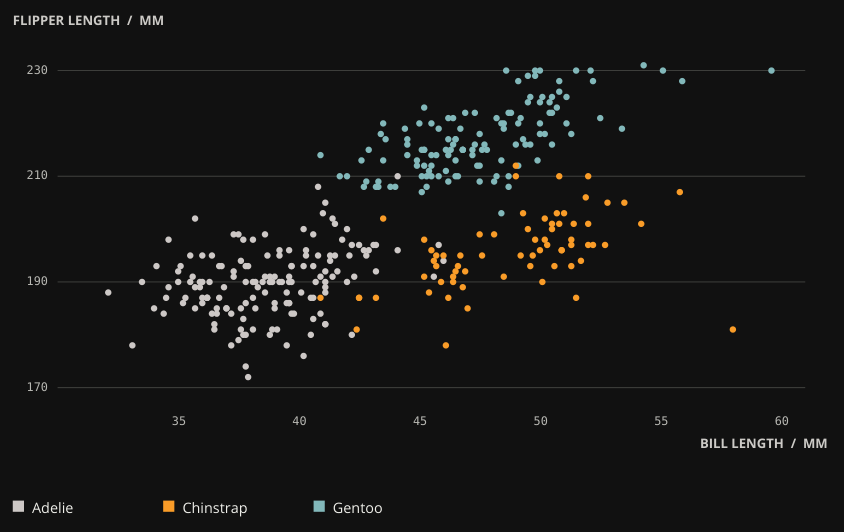

# Tutorial: Databricks Free Edition with Palmer Penguins

**Palmer field guide · Data engineering and AI · 16 November 2026**

The field team recorded 344 penguin observations over three seasons. How many have a weight? Follow the records from the original CSV to a dashboard and a chat answer you can check. When you outgrow the free tier, the production-scale version of this discipline is my book [*MLOps with Databricks on Azure End-to-End*](https://www.amazon.com/dp/B0FTSY78DR).

## Contents

Start with the [field brief](#field-brief) for hands-on work or the [platform overview](#platform-overview) for a reading-first route. Choose Manual or Genie for each lab.

| Lab | Field exercise | Manual | Genie | Reading |
| --- | --- | --- | --- | --- |
| 01 | Create your work area | [Manual](labs-01-05/#manual-lab-01) | [Genie](labs-01-05/#genie-lab-01) | [Field notes](labs-01-05/#field-notes-01) |
| 02 | Split the survey into two deliveries | [Manual](labs-01-05/#manual-lab-02) | [Genie](labs-01-05/#genie-lab-02) | [Field notes](labs-01-05/#field-notes-02) |
| 03 | Count the records and weights | [Manual](labs-01-05/#manual-lab-03) | [Genie](labs-01-05/#genie-lab-03) | [Field notes](labs-01-05/#field-notes-03) |
| 04 | Load the first file into Bronze | [Manual](labs-01-05/#manual-lab-04) | [Genie](labs-01-05/#genie-lab-04) | [Field notes](labs-01-05/#field-notes-04) |
| 05 | Keep each observation, then count by group | [Manual](labs-01-05/#manual-lab-05) | [Genie](labs-01-05/#genie-lab-05) | [Field notes](labs-01-05/#field-notes-05) |
| 06 | Let the late file start the job | [Manual](labs-06-10/#manual-lab-06) | [Genie](labs-06-10/#genie-lab-06) | [Field notes](labs-06-10/#field-notes-06) |
| 07 | Find out why the job failed | [Manual](labs-06-10/#manual-lab-07) | [Genie](labs-06-10/#genie-lab-07) | [Field notes](labs-06-10/#field-notes-07) |
| 08 | Rebuild the summary on canvas | [Manual](labs-06-10/#manual-lab-08) | [Genie](labs-06-10/#genie-lab-08) | [Field notes](labs-06-10/#field-notes-08) |
| 09 | Match the two names for each species | [Manual](labs-06-10/#manual-lab-09) | [Genie](labs-06-10/#genie-lab-09) | [Field notes](labs-06-10/#field-notes-09) |
| 10 | Inspect access and lineage | [Manual](labs-06-10/#manual-lab-10) | [Genie](labs-06-10/#genie-lab-10) | [Field notes](labs-06-10/#field-notes-10) |
| 11 | Define “weighed” once | [Manual](labs-11-15/#manual-lab-11) | [Genie](labs-11-15/#genie-lab-11) | [Field notes](labs-11-15/#field-notes-11) |
| 12 | Publish the station brief | [Manual](labs-11-15/#manual-lab-12) | [Genie](labs-11-15/#genie-lab-12) | [Field notes](labs-11-15/#field-notes-12) |
| 13 | Teach the analyst’s agent | [Manual](labs-11-15/#manual-lab-13) | [Genie](labs-11-15/#genie-lab-13) | [Field notes](labs-11-15/#field-notes-13) |
| 14 | Test a weight prediction | [Manual](labs-11-15/#manual-lab-14) | [Genie](labs-11-15/#genie-lab-14) | [Field notes](labs-11-15/#field-notes-14) |
| 15 | Find an observation by similarity | [Manual](labs-11-15/#manual-lab-15) | [Genie](labs-11-15/#genie-lab-15) | [Field notes](labs-11-15/#field-notes-15) |
| 16 | Use a tested lookup in chat | [Manual](labs-16-20/#manual-lab-16) | [Genie](labs-16-20/#genie-lab-16) | [Field notes](labs-16-20/#field-notes-16) |
| 17 | Catch a fluent wrong answer | [Manual](labs-16-20/#manual-lab-17) | [Genie](labs-16-20/#genie-lab-17) | [Field notes](labs-16-20/#field-notes-17) |
| 18 | Record the human decision | [Manual](labs-16-20/#manual-lab-18) | [Genie](labs-16-20/#genie-lab-18) | [Field notes](labs-16-20/#field-notes-18) |
| 19 | Serve the station brief | [Manual](labs-16-20/#manual-lab-19) | [Genie](labs-16-20/#genie-lab-19) | [Field notes](labs-16-20/#field-notes-19) |
| 20 | Answer the station lead | [Manual](labs-16-20/#manual-lab-20) | [Genie](labs-16-20/#genie-lab-20) | [Field notes](labs-16-20/#field-notes-20) |

**Briefing and reference**

- [Free Edition overview](#free-edition-overview)
- [Summit updates](#summit-updates)
- [Field brief](#field-brief)
- [Acceptance checks](appendix/#acceptance-checks)
- [Sources and credits](#sources-and-credits)
- [Offline archive step 1](appendix/#offline-archive-step-1)
- [Offline archive step 2](appendix/#offline-archive-step-2)
- [Genie offline archive](appendix/#genie-offline-archive)
- [Diagnosing a Genie answer](appendix/#diagnosing-a-genie-answer)
- [Choosing an agent](appendix/#choosing-an-agent)
- [Platform overview](#platform-overview)

**Answer key**

[Answers for labs 01 to 05](appendix/#answers-for-labs-01-to-05) · [Answers for labs 06 to 10](appendix/#answers-for-labs-06-to-10) · [Answers for labs 11 to 15](appendix/#answers-for-labs-11-to-15) · [Answers for labs 16 to 20](appendix/#answers-for-labs-16-to-20)

## Free Edition overview

### What Free Edition includes

You can run this tutorial in a browser with a free Databricks account. Choose Free Edition when you sign up. It replaced Community Edition in 2025 and is intended for personal, non-commercial work.

#### Account and compute

Choose Free Edition when signing up. No credit card or cloud contract is required. Your account has one workspace and one metastore, serverless compute and managed storage. Python and SQL are supported. The single SQL warehouse is capped at 2X-Small.

#### Quotas and recovery

The published limits include five concurrent job tasks per account and one active pipeline per pipeline type. If you exhaust fair use, compute can pause for the remainder of the day or, in extreme cases, the month. Your data and settings persist through the pause.

#### AI, apps and databases

You can experiment with selected foundation models, model serving and tool calling. AI Search allows one endpoint with one search unit. Direct Vector Access, Knowledge Assistant, GPU serving and provisioned throughput are excluded. You can run up to three Databricks Apps. An app automatically stops 24 hours after its latest start, update or redeployment. Lakebase allows one scale-to-zero project.

#### Administration

Free Edition omits R and Scala, custom compute configurations, the account console, SSO/SCIM, private networking and compliance controls. Outbound networking is restricted. The service has no SLA or official support. Commercial use is prohibited.

#### Genie terminology

Use Genie Code when you want help building a table or fixing a notebook. Ask a Genie Agent when you want an answer from data it can read. Genie One is a chat interface that can find an agent for your question.

**The more you know**

Eligible users can verify their identity for limited AI Runtime access. This guide uses ordinary serverless compute and its workspace volume.

**Sources** · [Free Edition overview](https://docs.databricks.com/aws/en/getting-started/free-edition) · [Edition limits](https://docs.databricks.com/aws/en/getting-started/free-edition-limitations) · [Free Edition vs. trial](https://docs.databricks.com/aws/en/getting-started/free-trial-vs-free-edition) · [Genie Code](https://docs.databricks.com/aws/en/genie-code/) · [Genie execution boundaries](https://docs.databricks.com/aws/en/databricks-ai/databricks-ai-trust)

[Contents](#contents)

## Summit updates

### What changed at the summit

The summit covered everything from connecting a sales system to streaming events as they happen. With the penguin data, you can try the same basic sequence on a smaller scale: bring in a file, turn it into tables and start a job when the next file arrives.

#### 01  Lakeflow Connect

Databricks announced 100+ built-in connectors across its ecosystem. Managed SaaS and database connectors have source-specific credentials and prerequisites. Lab 04 uses the standard file-connector route. Zerobus Ingest also supports direct event writes to Delta, with writes under five seconds reported by Databricks. The lab measures file arrivals separately.

#### 02  Spark Declarative Pipelines

Real-Time Mode targets latency as low as five milliseconds in suitable continuous flows. In labs 04–06 the pipeline reads each new file once. When the second file arrives, you can watch the island totals change.

#### 03  Lakeflow Jobs

Databricks reported 50+ integrations. In lab 06, file arrival starts a job with a pipeline task and a dependent notebook. The job starts when the file arrives. You can see which file and run to check if the totals look wrong.

#### 04  Designer, Genie Code and ZeroOps

Designer reached general availability in June, and Databricks explicitly confirms Free Edition access. Genie Code can edit its canvas. ZeroOps can investigate failures and propose fixes but requires an enabled workspace preview. Lab 07 uses task output, Genie Code and a repair run.

#### 05  Unity Catalog and Genie Ontology

Unity Catalog shows who can read a table and where its data came from. Genie Ontology reached general availability in November 2026. Genie combines definitions you publish with context it learns from assets and usage. Lab 09 supplies species names. Lab 11 supplies the rule for “weighed”. Lab 13 tests whether the agent actually uses that rule.

**Sources** · [Summit announcement](https://www.databricks.com/blog/lakeflow-new-era-agentic-data-engineering) · [Lakeflow file connectors](https://docs.databricks.com/aws/en/ingestion/lakeflow-connect/file-connectors-overview) · [ZeroOps requirements](https://docs.databricks.com/aws/en/zeroops/get-started) · [Real-Time Mode](https://docs.databricks.com/aws/en/ldp/real-time) · [Designer availability](https://www.databricks.com/blog/whats-new-lakeflow-designer-october-2026-roundup) · [November release notes](https://docs.databricks.com/aws/en/release-notes/product/2026/november) · [Genie Ontology](https://docs.databricks.com/aws/en/genie/genie-ontology/)

[Contents](#contents)

## Field brief

### The Palmer field brief

The field team has finished three seasons of penguin surveys. The station lead asks: “How many observations did we make on each island, and how many have a recorded weight?” You’ll follow one CSV all the way to a dashboard and a chat answer the lead can check.

#### The archive

Palmer Station Antarctica LTER and Kristen Gorman and collaborators collected the field data. The palmerpenguins project distributes the simplified CC0 file. It contains 344 records from three species, three islands and three survey years. The second source is a three-name extract from the ITIS taxonomy record in lab 09.

#### Why make three tables?

Bronze keeps the entries as the field team sent them. Silver gives you one row per observation with measurements you can use in calculations. Gold answers a question people ask often, such as “How many records have a weight on each island?” You can always go back to the individual entries to check a total.

#### Where your files go

The examples use your writable catalog, workspace. The project’s tables live in workspace.palmer_lab and its files go in /Volumes/workspace/palmer_lab/landing.

#### What runs where

Each notebook holds code in cells. For Python, choose Serverless in the notebook’s compute menu. A Serverless SQL warehouse runs SQL cells only. If you open a Python cell and see a warehouse selected, switch the compute to Serverless. For a saved notebook run by a job, choose Serverless again in the job task. Files saved in a volume stay there after the notebook session ends.

#### How to work through each lab

For a reading-first pass, start with [platform overview](#platform-overview). Each lab links to its field notes. For hands-on work choose one continuous route. Track A starts in [Manual lab 01](labs-01-05/#manual-lab-01) with the commands you type. Track B starts in [Genie lab 01](labs-01-05/#genie-lab-01) and walks through all 20 labs using Genie. Each B lab includes its own setup, prompts, actions and results. Genie’s code can look different. Run it in the named editor and check the result.

#### Verification

The counts, missing weights, lookups and prediction errors were checked against the source data. Your messages confirm the volume, the Bronze repair and a successful file-triggered delivery with Gold at 344 / 342 / 2. For the rest, compare your own run with the checkpoint in each section.

**The more you know**

Already have bronze_obs? Check for 224 rows from first.csv in lab 04. Then continue with Silver and Gold in [Manual lab 05](labs-01-05/#manual-lab-05) or [Genie lab 05](labs-01-05/#genie-lab-05).

**Sources** · [Publisher’s CSV](https://raw.githubusercontent.com/allisonhorst/palmerpenguins/main/inst/extdata/penguins.csv) · [Dataset and original studies](https://github.com/allisonhorst/palmerpenguins) · [CC0 licence](https://allisonhorst.github.io/palmerpenguins/LICENSE.html) · [ITIS taxonomic record](https://www.itis.gov/servlet/SingleRpt/SingleRpt?search_topic=TSN&search_value=174444) · [Genie Ontology](https://docs.databricks.com/aws/en/genie/genie-ontology/) · [Choose notebook compute](https://docs.databricks.com/aws/en/compute/serverless/notebooks)

[Contents](#contents)

## Platform overview

### How the pieces fit together

Follow one penguin observation through the platform. The field worker records a weight, the station counts it, and a colleague asks about it in chat. Along the way, the storage, the calculation and the meaning of the result each have a different owner.

#### What is a lakehouse?

A lakehouse lets you keep files in cloud storage and work with them as reliable, queryable tables. The publisher’s CSV in landing is an ordinary file. A Delta table adds a transaction log to column-oriented data files. The log records which files belong to a committed version. Someone reading during a write sees a consistent table snapshot. This is one reason the team can query results while new observations are arriving.

#### Which service does which job?

| When the team wants to… | Where it happens in this survey |
| --- | --- |
| Keep the original or name a table | A Unity Catalog volume holds the source CSV. The catalog and schema give the tables names, ownership and permissions. |
| Turn deliveries into a report | Spark processes data in the pipeline. Bronze captures inputs, Silver cleans measurements and Gold groups them. Lakeflow Jobs decides when the pipeline and its check run. |
| Ask a question or publish an answer | A SQL warehouse runs analytical queries. A metric view defines “weighed”. A dashboard, a Genie Agent and an app can present the resulting numbers. |
| Record a human decision | Lakebase Postgres holds the current review state. Checking the case changes the review record while the original observation still lacks a weight. |

#### A fast way to read this guide

Each of the next 20 sections follows one lab. Read the opening question, then try “Check your understanding” from memory. The answer key explains the reasoning. The end of each section links to both practical routes. In either route, “Field notes” brings you back to the corresponding field notes.

**Sources** · [Lakehouse fundamentals](https://docs.databricks.com/aws/en/lakehouse/) · [Delta tables and transactions](https://docs.databricks.com/aws/en/delta/) · [Work with volume files](https://docs.databricks.com/aws/en/volumes/volume-files) · [Unity Catalog privileges](https://docs.databricks.com/aws/en/data-governance/unity-catalog/best-practices) · [Pipeline refresh behavior](https://docs.databricks.com/aws/en/ldp/concepts/refresh)

[Contents](#contents)

> 📚 **Where this goes next.** These labs run on Free Edition quotas with one small CSV. The moment the same pipeline has to survive real volumes, schema drift, model registries and deployment gates, you are in MLOps territory. [*MLOps with Databricks on Azure End-to-End*](https://www.amazon.com/dp/B0FTSY78DR) covers that ground with the same hands-on discipline, and its free [code companion](https://mohammed-brueckner.com/mlopswithdatabricks/) lives on this site.

## Sources and credits

### Sources and data credits

Each lab links to the Databricks instructions it uses. This section also tells you where the field records and the scientific names came from, so you can check either one against its source. The screens in this tutorial follow Databricks on AWS.

#### Free Edition and the summit

For account rules, use the Free Edition signup and limits pages. The summit announcement covers connectors and speed claims across the platform. The October Designer update confirms access on Free Edition. The ZeroOps guide explains which preview you would need.

#### Where Genie gets its answers

Genie can use definitions you publish and clues it learns from workspace activity. In lab 11 you supply a definition yourself: “weighed” counts records with a body mass. Unity Catalog controls which data a user can read.

#### Data sources

Palmer Station Antarctica LTER and Kristen B. Gorman collected the observations. Allison Horst, Alison Hill and Kristen Gorman prepared palmerpenguins (2020). The project repository links the original three Environmental Data Initiative study records. The simplified CSV is distributed under CC0. The genus record from the Integrated Taxonomic Information System supplies the scientific names in lab 09.

#### Reproducibility

Both ways of getting the CSV give you the same 344 rows and eight columns. The notebook checks the contents before it saves the file. If your workspace can’t reach the publisher, the appendix contains the file itself. All the work stays in Databricks.

#### Edition note

Rebuilt 15 November 2026 for catalog workspace. Source checks for the platform guide were performed on 14 November. Your transcript confirms the project volume. Your screenshot also shows Bronze rows after Genie repaired its Python file. For counts and later steps, use the checks in your own workspace.

#### Following up on an agent answer

[Diagnosing a Genie answer](appendix/#diagnosing-a-genie-answer) explains the agent settings that change what a colleague sees, how a question is answered and how you test it.

**Sources** · [Free Edition overview](https://docs.databricks.com/aws/en/getting-started/free-edition) · [Publisher’s CSV](https://raw.githubusercontent.com/allisonhorst/palmerpenguins/main/inst/extdata/penguins.csv) · [ITIS taxonomic record](https://www.itis.gov/servlet/SingleRpt/SingleRpt?search_topic=TSN&search_value=174444) · [Editorial design reference](https://platformeconomies.com/)

[Contents](#contents)

---

## About the author

Mohammed Brückner is an enterprise architect in Munich, building production machine learning platforms on Azure and Databricks. More at [mohammed-brueckner.com](https://mohammed-brueckner.com) — and for talks or workshops on data platforms and enterprise AI, see [Speaking & Workshops](https://mohammed-brueckner.com/speaking/).

Books: [*Machine Learning Operations (MLOps) with Databricks on Azure End-to-End*](https://www.amazon.com/dp/B0FTSY78DR) — the production-scale continuation of this tutorial — and [Platform Economies](https://platformeconomies.com) (2026), on what happens when the API becomes the product.
