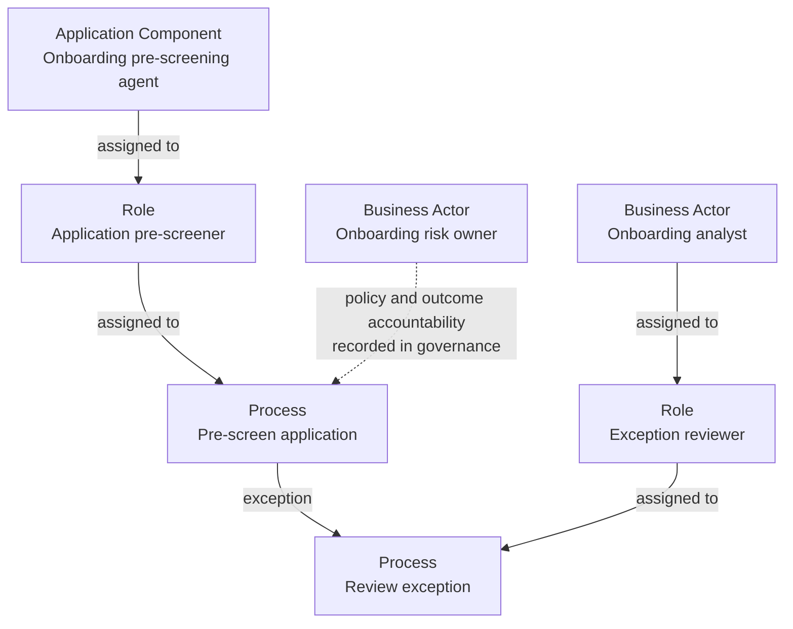

# Modeling AI Agents in ArchiMate 4: Roles Without Fake Accountability

**Model the AI software as an Application Component. Model the responsibility it performs as a Role, and use Assignment relationships to connect performers, roles, and behavior as appropriate. Then record the accountable human or organization separately.** An assignment can show that software performs work. It cannot make that software legally or organizationally accountable.

That distinction matters because an agent-shaped box has a strange effect on otherwise sensible design reviews. Once the box says “loan agent” or “onboarding agent,” people start attributing judgment, authority, and ownership to it. The diagram has answered questions the notation never asked.

ArchiMate 4 makes mixed human and machine work easier to represent. It does not repeal accountability.

## What ArchiMate 4 changes for this work

The Open Group released ArchiMate 4 in April 2026. Marc Lankhorst's explanation of the released changes describes two useful shifts:

- Layer-specific behavior concepts are consolidated into common concepts. A Process no longer needs a Business, Application, or Technology prefix before you know who or what performs it.
- Generic Role and Assignment concepts make it easier to show multiple performers contributing to the same behavior, including people and machines working together.

The practical benefit is simple: you can model one process with several performers instead of splitting a piece of work into artificial “human” and “software” processes and then stitching the fragments back together.

This is a modeling improvement, not a transfer of legal personhood to software. It also does not turn every AI feature into an agent. Start with what the component actually does in your architecture, not what the vendor keynote calls it.

## The decision table

Use this table before choosing names for the boxes. The right-hand column is the part people quietly infer when nobody says it out loud.

| Question | What to model | What the model does **not** establish |
|---|---|---|
| What executes the software logic? | An **Application Component**, such as “Onboarding pre-screening agent” | Human judgment, legal personality, or ownership |
| Which responsibility is assigned in this context? | A generic **Role**, such as “Application pre-screener” | Unlimited authority or accountability for the outcome |
| What work is performed? | A **Process** or **Function**, such as “Pre-screen application” | That the process is safe, approved, or useful |
| Which elements perform that work? | **Assignment** relationships among the relevant active-structure elements, roles, and behavior | A RACI matrix, delegated signing authority, or a control owner |
| Who handles exceptions? | A human **Business Actor** assigned to an exception-review Role and Process | That escalation happens automatically in the implementation |
| Who owns the policy and its consequences? | A named human or organizational actor, linked to the governance record and requirements | A magical accountability property inherited by the AI component |

The key is to keep three sentences separate:

1. **The component performs this computation.**
2. **The component is assigned this responsibility in the model.**
3. **This person or organization is accountable for the decision and its consequences.**

If the third sentence has no named answer, the model is not finished.

## A worked example: onboarding with an exception path

This example is illustrative. It is not a client case or a claim about a production system.

A team wants an AI component to pre-screen onboarding applications. The component may request additional data, but it may not approve an application. A human analyst reviews exceptions, and a named risk owner owns the policy.

*This is an accountability map, not a normative ArchiMate rendering. Use the element and relationship decisions above to build and validate the equivalent view in your ArchiMate 4-capable tool.*

The map deliberately separates four things:

- The **Application Component** supplies the automated behavior.
- The **Role** describes the responsibility assigned in this context.
- The **exception Process** makes human review visible instead of leaving it in a meeting note.
- The **risk owner** remains a human or organizational actor. The dotted accountability annotation points to governance, not to a new ArchiMate relationship type.

A repository entry or architecture decision record should now answer the questions the diagram should not carry: which data the component may use, which thresholds trigger review, who can change those thresholds, and which evidence demonstrates that the exception path works.

## Where the notation stops

ArchiMate can describe structure, behavior, responsibility, and relationships. It is not your complete governance system.

Do not ask a Role named “Accountable AI Owner” to settle legal liability. Do not infer a control owner from an Assignment. Do not let “human in the loop” stand in for a designed exception path. Those are governance claims, and they need owners, rules, and operational evidence.

Keep the following alongside the model:

- **Decision rights:** who may approve, reject, override, and change the policy.
- **Requirements:** which cases require human review and which actions are prohibited.
- **Operational evidence:** logs, review records, test results, and named owners for exceptions.
- **Change control:** who may alter the model, prompts, tools, thresholds, or connected services.

If that sounds less elegant than one agent box, good. Reality is under no obligation to fit your canvas.

## Tooling and migration notes

Check that your modeling tool and exchange format support the ArchiMate 4 concepts you intend to use. Older models may still contain layer-specific Process and Role variants. Do not bulk-convert a working repository because a new specification exists; test a representative model, its relationships, and the exchange path first.

The Open Group emphasizes user-level compatibility, but compatibility does not mean every tool released an update on the same day. Your repository and your toolchain have their own migration calendar.

## The accountability checklist

Before calling an AI-agent view complete, ask:

- [ ] Is the AI software distinct from the Role it performs?
- [ ] Is each automated behavior attached to a real Application Component?
- [ ] Are human and machine performers shown without duplicating one process unnecessarily?
- [ ] Is there a designed exception path with a named human role?
- [ ] Is the accountable human or organization identified outside the agent box?
- [ ] Are decision rights and prohibited actions recorded as requirements or governance decisions?
- [ ] Can the team produce evidence that escalation and override work in operation?
- [ ] Has the model been opened and checked in the tool that will actually maintain it?

---

## References

- The Open Group, *[The Motivation for Changes in the ArchiMate 4 Specification](https://publications.opengroup.org/w262)*, W262, published 27 April 2026.
- The Open Group, *[ArchiMate 4 Specification release announcement](https://www.opengroup.org/The-Open-Group-Announces-ArchiMate%C2%AE-4-Specification)*, April 2026.
- Marc Lankhorst, Bizzdesign, *[What Really Changes in the ArchiMate 4 Specification and What Does Not](https://bizzdesign.com/blog/archimate-4-changes)*, August 2026. A first-hand explanation by a co-author of the Open Group white paper.

## Related guides

- [Enterprise Architecture](..) — the connected EA guides
- [Architecture as Code](../../archimate/) — reviewable models and diagrams
- [Archify](../../archify/) — attaching repository evidence to generated diagrams
- [The Threshold Test](../../threshold-test/) — deciding whether an AI proposal deserves investment

**About the author:** Mohammed Brückner is an enterprise architect and author in Munich, working on IT strategy, enterprise architecture, and digital transformation. More connected guides live on the [Enterprise Architecture hub](..).
