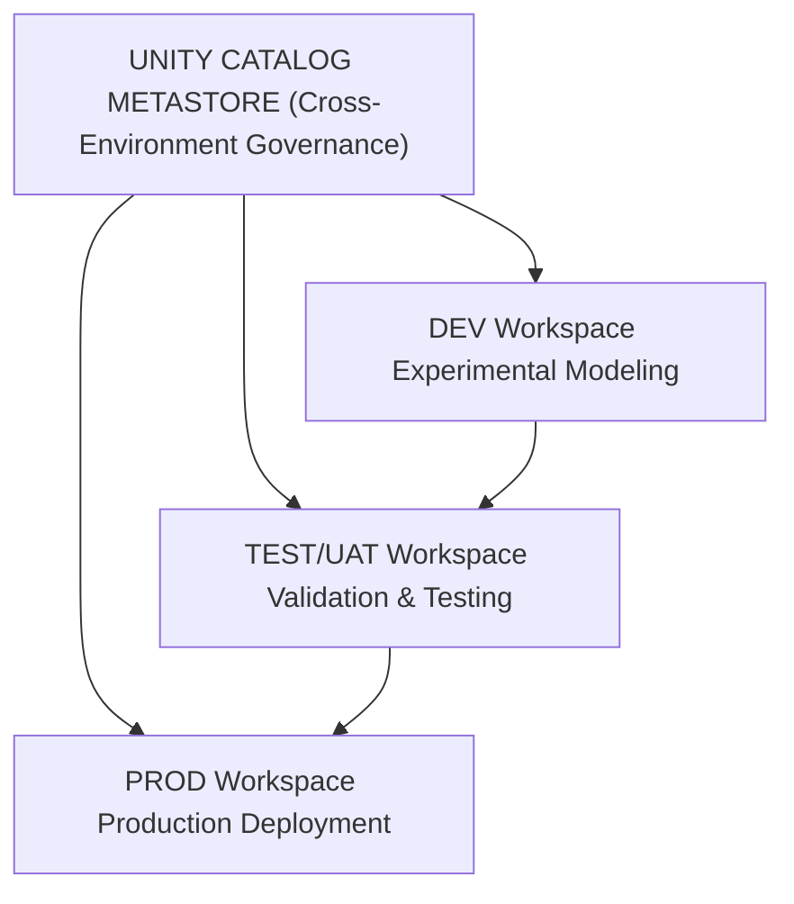

# MLOps on Azure Databricks: Scripts and Field Notes for the Full Lifecycle

Working code for running machine learning in production on Azure Databricks: the CLI commands to stand up the environments, the MLflow and Unity Catalog configuration, the compute and cost settings, and the deployment, monitoring and governance pieces that keep a platform honest. Every snippet is copy-paste ready, and every chapter carries the field notes I wish someone had handed me before the first production incident — the judgment calls around the code, not just the code.

The material grew out of my book [Machine Learning Operations (MLOps) with Databricks on Azure End-to-End](https://www.amazon.com/dp/B0FTSY78DR), but this page stands on its own: use it as a checklist, steal the scripts, argue with the defaults.

---

## Table of Contents

- [Getting Started: Hands-On Setup](#getting-started-hands-on-setup)
- [Chapter 2: The Three Workspaces](#chapter-2-the-three-workspaces)
- [Chapter 3: The Central Hub of MLflow](#chapter-3-the-central-hub-of-mlflow)
- [Chapter 4: Crafting Reproducible Environments](#chapter-4-crafting-reproducible-environments)
- [Chapter 5: Configuring the Compute Foundation](#chapter-5-configuring-the-compute-foundation)
- [Chapter 6: Managing the Economics of Compute](#chapter-6-managing-the-economics-of-compute)
- [Chapter 7: Securing the Workspace](#chapter-7-securing-the-workspace)
- [Chapter 8: Deployment and Serving](#chapter-8-deployment-and-serving)
- [Chapter 9: The Propagation of Work](#chapter-9-the-propagation-of-work)
- [Chapter 10: The Practice of Monitoring](#chapter-10-the-practice-of-monitoring)
- [Chapter 11: The Feature Store](#chapter-11-the-feature-store)
- [Chapter 12: Governance and Lineage](#chapter-12-governance-and-lineage)
- [Chapter 13: Recovery and Resilience](#chapter-13-recovery-and-resilience)
- [Chapter 14: Compliance and Auditing](#chapter-14-compliance-and-auditing)

---

## Getting Started: Hands-On Setup

This section deploys a functional MLOps skeleton on Azure and Databricks with nothing but the command line: three resource groups, a network perimeter, three workspaces, and a Unity Catalog metastore. Follow it top to bottom and you end up with a working DEV/TEST/PROD layout.

### Field Notes

Two traps before you run anything. **First, the CLI generation.** The `pip install databricks-cli` below installs the legacy CLI, which is in maintenance mode. The current Databricks CLI — the one that understands `bundle deploy` — is a separate binary install. Check which one you have with `databricks version` before a tutorial sends you down the wrong path. **Second, authentication.** The account-console username and password in Step 4 still work in places, but the direction of travel is **service principals with OAuth** — especially once CI enters the picture, because a token tied to a person leaves with that person.

Two more from experience. Use **Azure Cloud Shell** for the Azure parts (pre-authenticated, nothing to install), and deploy every workspace into the **same region** as your metastore — Unity Catalog metastores are regional, and a workspace can only attach to a metastore in its own region. Finally, the **Premium SKU** is not optional here: Unity Catalog and the audit logs used later in this guide require it. Standard tier will get you a workspace and then stop cooperating.

### Prerequisites

Before you begin, ensure you have the following tools installed and configured:

**Pro Tip:** A great way to get started with minimal setup is to use the Azure Cloud Shell. It's a browser-based shell environment that has the Azure CLI pre-installed and authenticated. You can launch it directly from the Azure Portal.

- **Azure CLI**: If working locally, ensure it is installed and you are authenticated to your Azure subscription (`az login`). This is already handled if you use Azure Cloud Shell.
- **Databricks CLI**: Install it with:
  ```bash
  pip install databricks-cli
  ```
- **An Azure Account**: You need an account with permissions to create resource groups, storage, networks, and Databricks workspaces.

### Step 1: Laying the Azure Foundation

Create three resource groups, one for each environment (DEV, TEST, PROD):

```bash
# Create resource groups for DEV, TEST, and PROD
az group create --name "mlops-dev-rg" --location "eastus2"
az group create --name "mlops-test-rg" --location "eastus2"
az group create --name "mlops-prod-rg" --location "eastus2"
```

### Step 2: The Network Perimeter

Create a Virtual Network (VNet) and dedicated subnets for Databricks workspaces:

```bash
# Create the Virtual Network
az network vnet create \
  --resource-group "mlops-prod-rg" \
  --name "mlops-vnet" \
  --address-prefix "10.0.0.0/16"

# Create the public and private subnets for Databricks
az network vnet subnet create \
  --resource-group "mlops-prod-rg" \
  --vnet-name "mlops-vnet" \
  --name "public-subnet" \
  --address-prefixes "10.0.1.0/24" \
  --delegations "Microsoft.Databricks/workspaces"

az network vnet subnet create \
  --resource-group "mlops-prod-rg" \
  --vnet-name "mlops-vnet" \
  --name "private-subnet" \
  --address-prefixes "10.0.2.0/24" \
  --delegations "Microsoft.Databricks/workspaces"
```

### Step 3: Deploying the Databricks Workspaces

Deploy three Databricks workspaces (DEV, TEST, PROD):

```bash
# Deploy the DEV workspace
az databricks workspace create \
  --resource-group "mlops-dev-rg" \
  --name "mlops-dev-workspace" \
  --location "eastus2" \
  --sku "premium"

# Deploy the TEST workspace
az databricks workspace create \
  --resource-group "mlops-test-rg" \
  --name "mlops-test-workspace" \
  --location "eastus2" \
  --sku "premium"

# Deploy the PROD workspace
az databricks workspace create \
  --resource-group "mlops-prod-rg" \
  --name "mlops-prod-workspace" \
  --location "eastus2" \
  --sku "premium"
```

### Step 4: The Governance Hub - Unity Catalog

Create a storage account for the Unity Catalog metastore:

```bash
# Create a globally unique storage account for the metastore root
STORAGE_ACCOUNT_NAME="ucmetastore$(openssl rand -hex 5)"

az storage account create \
  --resource-group "mlops-prod-rg" \
  --name $STORAGE_ACCOUNT_NAME \
  --sku "Standard_LRS" \
  --kind "StorageV2"
```

**Manual Step Required**: Create the metastore in the Databricks Account Console:
1. Navigate to your Databricks Account Console
2. Create a new metastore, assigning it to the storage account created above
3. Assign your DEV, TEST, and PROD workspaces to this new metastore

After the manual step, configure the Databricks CLI and create catalogs:

```bash
# Configure Databricks CLI (requires a PAT token from your Databricks Account user)
export DATABRICKS_HOST="https://accounts.azuredatabricks.net"
export DATABRICKS_ACCOUNT_ID="your-account-id"
export DATABRICKS_USERNAME="your-account-user"
export DATABRICKS_PASSWORD="your-account-password"

# Create catalogs for each environment
databricks unity-catalog catalogs create --name "ml_dev_catalog"
databricks unity-catalog catalogs create --name "ml_test_catalog"
databricks unity-catalog catalogs create --name "ml_prod_catalog"
```

### Step 5: A Glimpse of Automation

Use Databricks Asset Bundles to define and deploy resources. Create a `databricks.yml` file:

```yaml
bundle:
  name: mlops_pipeline

targets:
  dev:
    workspace:
      # Get this from the Azure Portal for your DEV workspace
      host: https://adb-<workspace-id>.azuredatabricks.net

    resources:
      jobs:
        hello_world_job:
          name: "Hello World DEV"
          tasks:
            - task_key: hello
              notebook_task:
                notebook_path: ./notebooks/hello.py
```

Create a simple notebook at `./notebooks/hello.py`:

```python
print("Hello from DEV!")
```

Deploy the bundle:

```bash
# Configure a profile for the DEV workspace
databricks configure --host <dev_workspace_url> --token

# Deploy the bundle to the dev target
databricks bundle deploy -t dev
```

---

## Chapter 2: The Three Workspaces

Three workspaces, one governance layer. The DEV/TEST/PROD split is what keeps a Friday-afternoon experiment away from Monday-morning revenue, and Unity Catalog is what keeps the split manageable.

### Field Notes

One metastore per region, all three workspaces attached — that is the pattern in the diagram, and it is the right one. The consequence people miss: **every catalog is visible from every workspace** unless you restrict it. Use **workspace-catalog bindings** to make the production catalog appear only in the production workspace, and grants to decide who can touch what. Visibility is not access, but a `prod` catalog that shows up in a developer's daily browsing will eventually get touched.

Why workspaces at all, and not three catalogs in one workspace? **Blast radius and billing.** Compute pools, cluster policies and workspace admin rights are workspace-scoped; separating workspaces separates both the accident surface and the cost centers. One workspace with three catalogs saves you two workspace deployments and costs you the isolation that was the entire point. (Ask me how I learned that ordering matters.)

The retention values in the registry config below are policy, not platform defaults — Unity Catalog will not enforce them for you. Automate the cleanup or accept the archaeology.

### Architecture Diagram



### Unity Catalog Metastore Configuration

```python
metastore_config = {
    "name": "company_mlops_metastore",
    "storage_root": "abfss://metastore@companydatalake.dfs.core.windows.net/",
    "region": "eastus2",
    "delta_sharing_scope": "INTERNAL_AND_EXTERNAL",
    "delta_sharing_recipient_token_lifetime": 90
}
```

### Catalog Structure per Environment

```python
catalog_structure = {
    "dev": {
        "catalog_name": "ml_dev_catalog",
        "schemas": ["raw", "feature_store", "experiments", "sandbox"]
    },
    "test": {
        "catalog_name": "ml_test_catalog",
        "schemas": ["raw", "feature_store", "validation", "staging"]
    },
    "prod": {
        "catalog_name": "ml_prod_catalog",
        "schemas": ["raw", "feature_store", "models", "serving"]
    }
}
```

### Model Registry Configuration

```python
model_registry_config = {
    "registry_type": "unity_catalog",
    "model_catalog": "ml_models_catalog",
    "schemas": {
        "dev_models": "Development stage models",
        "candidate_models": "Models ready for validation",
        "production_models": "Production-deployed models",
        "archived_models": "Deprecated model versions"
    },
    "retention_policy": {
        "dev": "30 days",
        "staging": "90 days",
        "production": "365 days",
        "archived": "730 days"
    }
}
```

---

## Chapter 3: The Central Hub of MLflow

MLflow on Databricks is not a tool you install but the backbone the platform is wired around: experiments, the model registry, and serving all speak MLflow natively.

### Field Notes

The single most consequential line in the config below is `registry_uri`. Point it at **Unity Catalog** (`databricks-uc://...`) and your models become governed assets with lineage and access control. Leave it at the default and you get the **workspace registry**, the legacy path that does not travel across workspaces.

Here is the gotcha that bites everyone once: **UC-registered models do not support stages.** The `transition_stage` endpoint in the REST config below belongs to the workspace-registry world. In Unity Catalog you promote with **aliases** (`model@champion`, `model@challenger`) or by copying a version into the next environment's catalog. Code that calls `transition_stage` against a UC model fails loudly, at least. Small mercies.

Also note the artifact locations. **DBFS root for MLflow artifacts is legacy**, and newer workspaces increasingly restrict it. Use a Unity Catalog **volume** or the `abfss://` path to your own storage account. And remember that experiments stay per-workspace even when the registry is shared — your DEV experiment history does not follow the model to PROD. Only the model does.

### MLflow Configuration Class

```python
class MLflowEnvironmentConfig:
    def __init__(self, environment: str):
        self.environment = environment
        self.configs = {
            "dev": {
                "tracking_uri": "databricks://dev-workspace",
                "registry_uri": "databricks-uc://ml_models_catalog.dev_models",
                "experiment_path": "/Workspace/ml_experiments/dev",
                "artifact_location": "abfss://mlflow-artifacts-dev@companydatalake.dfs.core.windows.net/",
                "backend_store_uri": "databricks://dev-workspace",
                "default_artifact_root": "dbfs:/ml-artifacts/dev"
            },
            "test": {
                "tracking_uri": "databricks://test-workspace",
                "registry_uri": "databricks-uc://ml_models_catalog.candidate_models",
                "experiment_path": "/Workspace/ml_experiments/test",
                "artifact_location": "abfss://mlflow-artifacts-test@companydatalake.dfs.core.windows.net/",
                "backend_store_uri": "databricks://test-workspace",
                "default_artifact_root": "dbfs:/ml-artifacts/test"
            },
            "prod": {
                "tracking_uri": "databricks://prod-workspace",
                "registry_uri": "databricks-uc://ml_models_catalog.production_models",
                "experiment_path": "/Workspace/ml_experiments/prod",
                "artifact_location": "abfss://mlflow-artifacts-prod@companydatalake.dfs.core.windows.net/",
                "backend_store_uri": "databricks://prod-workspace",
                "default_artifact_root": "dbfs:/ml-artifacts/prod"
            }
        }
    
    def get_config(self):
        return self.configs[self.environment]
```

### MLflow REST API Configuration

```python
mlflow_api_config = {
    "base_urls": {
        "dev": "https://adb-dev-workspace.azuredatabricks.net/api/2.0/mlflow",
        "test": "https://adb-test-workspace.azuredatabricks.net/api/2.0/mlflow",
        "prod": "https://adb-prod-workspace.azuredatabricks.net/api/2.0/mlflow"
    },
    "endpoints": {
        "create_experiment": "/experiments/create",
        "log_model": "/runs/log-model",
        "register_model": "/registered-models/create",
        "transition_stage": "/model-versions/transition-stage",
        "get_model_version": "/model-versions/get",
        "search_models": "/registered-models/search",
        "create_deployment": "/endpoints/create",
        "update_deployment": "/endpoints/update"
    },
    "authentication": {
        "method": "bearer_token",
        "token_location": "Azure Key Vault",
        "service_principal": True
    }
}
```

---

## Chapter 4: Crafting Reproducible Environments

"Works on my machine" is where ML projects go to die. Pinned dependencies, a versioned wheel, and checksums on serialized models are the boring machinery that makes a training run repeatable six months later.

### Field Notes

The dependency list below is the right shape, but treat the pins as a **delta on top of a Databricks Runtime**, not as a fresh environment. The ML runtimes already ship sklearn, pandas, numpy and friends; pip-installing a conflicting pin over the runtime's own versions is the classic way to produce a cluster that starts fine and fails in hour three. Pick the **runtime version as your base pin** and only add what the runtime does not provide.

Two practical notes on the wheel flow. First, `dbfs cp` for libraries is the old world — DBFS-root library uploads are deprecated and disabled by default on newer workspaces. Put the wheel in a **Unity Catalog volume** or a workspace file location instead. Second, the checksum in the serializer is not ceremony. Object storage is reliable but humans re-upload files under the same name, and a thirty-second integrity check has saved me from at least one "the model changed overnight" investigation that was, in fact, a Tuesday-afternoon overwrite.

### Python Dependencies Dictionary

```python
ml_dependencies = {
    "core_ml": [
        "scikit-learn==1.7.0",
        "xgboost==2.2.0",
        "lightgbm==4.6.0",
        "pandas==2.3.0",
        "numpy==2.1.0",
        "scipy==1.15.0",
        "statsmodels==0.14.2",
    ],
    "deep_learning": [
        "tensorflow==2.18.0",
        "torch==2.5.0",
        "transformers==4.43.0"
    ],
    "validation_monitoring": [
        "great-expectations==0.18.15",
        "evidently==0.6.0"
    ],
    "databricks": [
        "mlflow==3.4.0",
        "databricks-sdk==0.36.0",
        "databricks-feature-engineering==1.0.0"
    ],
    "serialization": [
        "cloudpickle==3.1.0",
        "joblib==1.5.0",
        "dill==0.4.0"
    ],
    "utils": [
        "pydantic==2.9.0",
        "python-dotenv==1.0.2",
        "requests==2.33.0",
        "pytest==8.4.0",
        "black==24.5.0",
        "pylint==3.3.0"
    ]
}
```

### setup.py for Python Wheel

```python
from setuptools import setup, find_packages

all_deps = [dep for category in ml_dependencies.values() for dep in category]

setup(
    name="company_ml_framework",
    version="1.0.0",
    packages=find_packages(),
    install_requires=all_deps,
    extras_require={
        "dev": ["pytest", "black", "pylint"],
        "prod": ["gunicorn", "uvicorn", "fastapi"]
    },
    entry_points={
        "console_scripts": [
            "train_model=company_ml.training:main",
            "deploy_model=company_ml.deployment:main",
            "monitor_model=company_ml.monitoring:main"
        ]
    },
    package_data={
        "company_ml": ["configs/*.yaml", "schemas/*.json"]
    }
)

# Build wheel: python setup.py bdist_wheel
# Upload: dbfs cp dist/company_ml_framework-1.0.0-py3-none-any.whl dbfs:/libs/
```

### Model Serialization Class

```python
import cloudpickle
import joblib
import pickle
import hashlib
from pathlib import Path
from typing import Any, Dict

class ModelSerializer:
    """Best practice model serialization handler"""
    
    @staticmethod
    def serialize_model(model: Any, path: str, method: str = "cloudpickle", 
                       compression: int = 3) -> Dict[str, str]:
        """Serialize ML model with metadata"""
        path = Path(path)
        
        if method == "cloudpickle":
            with open(path, 'wb') as f:
                cloudpickle.dump(model, f)
        elif method == "joblib":
            joblib.dump(model, path, compress=compression)
        elif method == "pickle":
            with open(path, 'wb') as f:
                pickle.dump(model, f)
        else:
            raise ValueError(f"Unknown serialization method: {method}")
        
        with open(path, 'rb') as f:
            checksum = hashlib.sha256(f.read()).hexdigest()
        
        metadata = {
            "serialization_method": method,
            "file_path": str(path),
            "file_size_mb": path.stat().st_size / (1024 * 1024),
            "checksum": checksum,
            "compression": compression if method == "joblib" else None
        }
        return metadata
    
    @staticmethod
    def deserialize_model(path: str, method: str = "cloudpickle", 
                         checksum: str = None) -> Any:
        """Deserialize model with integrity check"""
        path = Path(path)
        
        if checksum:
            with open(path, 'rb') as f:
                actual_checksum = hashlib.sha256(f.read()).hexdigest()
            if actual_checksum != checksum:
                raise IOError("Model checksum mismatch. File may be corrupt.")
        
        if method == "cloudpickle":
            with open(path, 'rb') as f:
                model = cloudpickle.load(f)
        elif method == "joblib":
            model = joblib.load(path)
        elif method == "pickle":
            with open(path, 'rb') as f:
                model = pickle.load(f)
        else:
            raise ValueError(f"Unknown deserialization method: {method}")
        
        return model
```

---

## Chapter 5: Configuring the Compute Foundation

Compute is where MLOps budgets live or die. The configuration below is the three-environment pattern: small and sleepy in DEV, production-shaped in TEST, production-sized in PROD.

### Field Notes

Pin your **runtime version** properly. The `17.2.x` rolling tag is convenient in DEV and a quiet liability in PROD — the `x` moves, and one day your reproducible pipeline runs on a different Spark than the one you validated. Production gets an exact version, ideally an **LTS** release.

**Photon** is on for PROD below and off elsewhere, which matches how I think about it: Photon accelerates Spark SQL and Delta workloads and does essentially nothing for a single-node sklearn training run. If your training is mostly pandas on the driver, Photon is an expensive decoration.

On sizing: autoscaling suits interactive clusters where load is unpredictable, but for scheduled jobs I prefer **fixed worker counts** — a job that takes 40 minutes every night is easier to budget and to alert on than one that takes 25 to 70 depending on the autoscaler's mood. And the **autotermination** values are not details: 30 minutes in DEV is the difference between a platform and a donation to Microsoft. The spot configuration in PROD belongs to the next chapter's economics; read the two together.

### Databricks Runtime Configuration

```python
runtime_config = {
    "dev": {
        "runtime_version": "17.2.x-ml-scala2.12",
        "spark_version": "3.6.0",
        "python_version": "3.12",
        "enable_photon": False,
        "node_type_id": "Standard_DS3_v2",
        "driver_node_type_id": "Standard_DS3_v2",
        "min_workers": 1,
        "max_workers": 4,
        "autoscale": True,
        "autotermination_minutes": 30,
        "spark_conf": {
            "spark.databricks.delta.preview.enabled": "true",
            "spark.databricks.delta.retentionDurationCheck.enabled": "false"
        }
    },
    "test": {
        "runtime_version": "17.2.x-ml-scala2.12",
        "spark_version": "3.6.0",
        "python_version": "3.12",
        "enable_photon": False,
        "node_type_id": "Standard_DS4_v2",
        "driver_node_type_id": "Standard_DS4_v2",
        "min_workers": 2,
        "max_workers": 8,
        "autoscale": True,
        "autotermination_minutes": 60,
        "spark_conf": {
            "spark.databricks.delta.optimizeWrite.enabled": "true",
            "spark.databricks.delta.autoCompact.enabled": "true"
        }
    },
    "prod": {
        "runtime_version": "17.2.x-ml-scala2.12",
        "spark_version": "3.6.0",
        "python_version": "3.12",
        "enable_photon": True,
        "node_type_id": "Standard_DS5_v2",
        "driver_node_type_id": "Standard_DS5_v2",
        "min_workers": 4,
        "max_workers": 16,
        "autoscale": True,
        "autotermination_minutes": 120,
        "spot_instances": {
            "enabled": True,
            "max_spot_price_percent": 100,
            "fall_back_to_on_demand": True
        },
        "spark_conf": {
            "spark.databricks.delta.optimizeWrite.enabled": "true",
            "spark.databricks.delta.autoCompact.enabled": "true",
            "spark.sql.adaptive.enabled": "true"
        }
    }
}
```

### Serverless Compute Configuration

```python
serverless_config = {
    "model_serving": {
        "compute_type": "SERVERLESS",
        "auto_capture_config": {
            "enabled": True,
            "catalog_name": "ml_prod_catalog",
            "schema_name": "model_inference_logs",
            "table_name_prefix": "inference_logs_"
        },
        "scaling_config": {
            "min_provisioned_throughput": 0,
            "max_provisioned_throughput": 100,
            "scale_down_delay": 300
        }
    },
    "workflow_jobs": {
        "compute_type": "SERVERLESS",
        "job_queue_enabled": True
    }
}
```

---

## Chapter 6: Managing the Economics of Compute

Databricks bills in DBUs, Azure bills for the underlying VMs, and once a month the invoice arrives to ask hard questions. This chapter is about having the answers ready.

### Field Notes

The DBU rates in the config below are **placeholders, not gospel**. Actual rates vary by workload type, tier and region, and they change — pull current numbers from the Databricks and Azure pricing pages before building a forecast on them. What *is* stable is the shape: **jobs compute is dramatically cheaper than all-purpose compute**, and serverless serving bills per use. The single biggest cost lever in most MLOps estates is moving scheduled work off interactive clusters onto job clusters. No re-architecture required.

The `system.billing.usage` table the monitor class queries is the real source of truth, but it is an **account-level system table** — someone has to enable system tables on the metastore before the query returns anything. (The symptom will not say that. It will just be empty.)

On **spot instances**: eviction is not theoretical, it happens mid-job, and it is quiet until you look. Make jobs idempotent so a rerun is boring, checkpoint what you can, and keep `fall_back_to_on_demand` on for anything with a deadline. Cheap compute that misses the SLA is not cheap.

### DBU Cost Optimization Strategy

```python
dbu_optimization = {
    "compute_types": {
        "all_purpose_compute": {
            "dev": {
                "dbu_rate": 0.55,
                "instance_pool": True,
                "idle_instance_auto_termination": 10
            },
            "test": {
                "dbu_rate": 0.55,
                "instance_pool": True,
                "idle_instance_auto_termination": 20
            },
            "prod": {
                "dbu_rate": 0.55,
                "instance_pool": False,
                "idle_instance_auto_termination": 30
            }
        },
        "jobs_compute": {
            "all_environments": {
                "dbu_rate": 0.15,
                "spot_instances": True,
                "spot_bid_max_price": 0.20
            }
        },
        "serverless_compute": {
            "model_serving": {
                "dbu_rate": 0.07,
                "auto_scale_to_zero": True
            }
        }
    },
    "commitment_discounts": {
        "dbcu_purchase": "3_year",
        "reserved_capacity": 10000
    }
}
```

### DBU Cost Monitoring Class

```python
from databricks.sdk import WorkspaceClient
from datetime import datetime, timedelta
import pandas as pd

class DBUCostMonitor:
    """Monitor and optimize DBU consumption"""
    
    def __init__(self, workspace_url: str, token: str):
        self.client = WorkspaceClient(host=workspace_url, token=token)
    
    def get_usage_metrics(self, days_back: int = 7) -> pd.DataFrame:
        """Retrieve DBU usage metrics"""
        end_time = datetime.now()
        start_time = end_time - timedelta(days=days_back)
        
        query = f"""
        SELECT
            workspace_id,
            sku_name,
            usage_date,
            usage_unit,
            SUM(usage_quantity) as total_dbu,
            SUM(usage_quantity *
                CASE
                    WHEN sku_name LIKE '%ALL_PURPOSE%' THEN 0.55
                    WHEN sku_name LIKE '%JOBS%' THEN 0.15
                    WHEN sku_name LIKE '%SERVERLESS%' THEN 0.07
                    ELSE 0.40
                END
            ) as estimated_cost_usd
        FROM system.billing.usage
        WHERE usage_date >= '{start_time.date()}'
            AND usage_date <= '{end_time.date()}'
        GROUP BY workspace_id, sku_name, usage_date, usage_unit
        ORDER BY usage_date DESC
        """
        
        return pd.DataFrame()
    
    def generate_cost_alerts(self, threshold_usd: float = 1000):
        """Generate alerts for cost overruns"""
        usage_df = self.get_usage_metrics(days_back=1)
        if usage_df.empty:
            return None
        
        daily_cost = usage_df['estimated_cost_usd'].sum()
        
        if daily_cost > threshold_usd:
            return {
                "severity": "HIGH",
                "message": f"Daily DBU cost ${daily_cost:.2f} exceeds threshold"
            }
        return None
```

> The DBU arithmetic in this chapter is one line item in a bigger question: what happens to platform economics when compute is metered by the second and AI agents start showing up as consumers. That is the subject of my other book, [Platform Economies](https://platformeconomies.com) — written for the people who have to justify the bill, not just run the workload.

---

## Chapter 7: Securing the Workspace

Security is foundational, not a phase. On Azure Databricks the perimeter is built from VNet injection, private endpoints and DNS zones — and the failures are almost always in the DNS zones.

### Field Notes

The classic private-endpoint failure mode is not a denied connection; it is a **forgotten DNS zone link**. You create the endpoint, everything tests fine from the wrong place, and then traffic either resolves to the public endpoint (silent — you find out in an audit) or fails with an opaque timeout (loud — you find out at 2 a.m.). Every endpoint in the config below needs its `privatelink` zone, the zone linked to the VNet, and the workspace's own `privatelink.azuredatabricks.net` records. Check name resolution from **inside** the VNet, not from your laptop.

Also note the dedicated **private-endpoint subnet** with network policies disabled — that is required, not a style choice, because private endpoints cannot live in subnets delegated to Databricks.

On identity: `DefaultAzureCredential` below is the right instinct. Keep personal access tokens for humans and emergencies, and put pipelines on **service principals** with secrets in Key Vault. And plan **secure cluster connectivity** (no public IPs on cluster nodes) from day one — retrofitting it into a running workspace means recreating things you would rather not recreate.

### Secure Networking Configuration

```python
network_config = {
    "vnet_configuration": {
        "vnet_name": "databricks-mlops-vnet",
        "address_space": "10.0.0.0/16",
        "subnets": {
            "public_subnet": {
                "name": "public-subnet",
                "address_prefix": "10.0.1.0/24",
                "delegation": "Microsoft.Databricks/workspaces"
            },
            "private_subnet": {
                "name": "private-subnet",
                "address_prefix": "10.0.2.0/24",
                "delegation": "Microsoft.Databricks/workspaces"
            },
            "private_endpoint_subnet": {
                "name": "pe-subnet",
                "address_prefix": "10.0.3.0/24",
                "private_endpoint_network_policies": "Disabled"
            }
        }
    },
    "private_endpoints": {
        "databricks_workspace": {
            "resource_type": "Microsoft.Databricks/workspaces",
            "group_id": "databricks_ui_api",
            "dns_zone": "privatelink.azuredatabricks.net"
        },
        "storage_account": {
            "resource_type": "Microsoft.Storage/storageAccounts",
            "group_ids": ["blob", "dfs"],
            "dns_zones": [
                "privatelink.blob.core.windows.net",
                "privatelink.dfs.core.windows.net"
            ]
        },
        "key_vault": {
            "resource_type": "Microsoft.KeyVault/vaults",
            "group_id": "vault",
            "dns_zone": "privatelink.vaultcore.azure.net"
        }
    }
}
```

### Secure Network Management Class

```python
from azure.identity import DefaultAzureCredential
from azure.mgmt.network import NetworkManagementClient
from azure.mgmt.privatedns import PrivateDnsManagementClient

class SecureNetworkManager:
    """Manage Azure private networking for MLOps"""
    
    def __init__(self, subscription_id: str, resource_group: str):
        self.subscription_id = subscription_id
        self.resource_group = resource_group
        self.credential = DefaultAzureCredential()
        self.network_client = NetworkManagementClient(
            self.credential, self.subscription_id
        )
        self.dns_client = PrivateDnsManagementClient(
            self.credential, self.subscription_id
        )
    
    def create_private_endpoint(self, endpoint_name: str, resource_id: str,
                               group_id: str, subnet_id: str) -> dict:
        """Create a private endpoint for secure access"""
        params = {
            "location": "eastus2",
            "subnet": {"id": subnet_id},
            "private_link_service_connections": [{
                "name": f"{endpoint_name}-connection",
                "private_link_service_id": resource_id,
                "group_ids": [group_id]
            }]
        }
        
        result = self.network_client.private_endpoints.begin_create_or_update(
            self.resource_group, endpoint_name, params
        ).result()
        
        return {
            "endpoint_id": result.id,
            "private_ip": result.custom_dns_configs[0].ip_addresses[0],
            "fqdn": result.custom_dns_configs[0].fqdn
        }
```

---

## Chapter 8: Deployment and Serving (continued)

A model that serves no traffic is an expensive file. This is where registered versions become endpoints.

### Field Notes

**Serving endpoints are slow to create and update** — think minutes. Endpoint creation belongs in a deployment pipeline that waits for the ready state before declaring victory, never in a request path or a user-facing flow.

The `auto_capture_config` block is the most valuable few lines in this chapter. **Inference tables** log every request and response to a Delta table automatically, which becomes the raw material for the monitoring chapter further down. Turn it on before you need it — the history you did not capture cannot be reconstructed.

**Scale-to-zero** (`min_provisioned_throughput: 0`) is right for dev and low-traffic endpoints, but know the trade: the first request after idle pays a cold start measured in tens of seconds, sometimes worse. For user-facing latency, keep the floor above zero.

On the traffic patterns below: Databricks implements **traffic splitting natively on a single endpoint**, so blue/green in practice means "shift the split", not "swap the endpoints". Shadow traffic is still a do-it-yourself pattern — the config below is honest about that: mirror the requests yourself and log for offline comparison.

### Advanced Serving Patterns Configuration

```python
serving_patterns = {
    "blue_green": {
        "strategy": "full_traffic_shift",
        "versions": [
            {"name": "blue", "model_version": "v1", "traffic": 100, "status": "active"},
            {"name": "green", "model_version": "v2", "traffic": 0, "status": "staging"}
        ],
        "promotion_steps": [
            "Deploy green version to 0% traffic",
            "Run smoke tests on green",
            "Shift 100% traffic to green",
            "Decommission blue"
        ]
    },
    "ab_testing": {
        "strategy": "canary_release",
        "configurations": [
            {"model_version": "v1.0", "traffic_percentage": 90, "user_segment": "control_group"},
            {"model_version": "v2.0", "traffic_percentage": 10, "user_segment": "treatment_group"}
        ],
        "monitoring_metrics": ["latency_p95", "error_rate", "business_kpi"]
    },
    "shadow_traffic": {
        "strategy": "passive_testing",
        "primary_model": "production_v1",
        "shadow_model": "candidate_v2",
        "traffic_split": "100% mirrored to shadow",
        "comparison": "log predictions for offline eval"
    }
}
```

### Custom pyfunc Scoring Class

```python
import mlflow
import pandas as pd
from sklearn.ensemble import RandomForestClassifier
import json

class ScoringService:
    def __init__(self):
        self.model = None
    
    def load_model(self, model_uri):
        """Load the model from the specified URI"""
        self.model = mlflow.sklearn.load_model(model_uri)
    
    def predict(self, data: pd.DataFrame) -> dict:
        """Generate predictions"""
        if self.model is None:
            raise RuntimeError("Model is not loaded.")
        
        predictions = self.model.predict_proba(data)
        
        return {
            "predictions": predictions.tolist(),
            "model_info": "custom_scoring_service_v1"
        }
```

---

## Chapter 9: The Propagation of Work

Getting a model from DEV to PROD should be a pipeline, not a ceremony. This chapter is the machinery: a promotion function, and Asset Bundles as the deployable unit.

### Field Notes

There is an old argument here: **deploy the model, or deploy the code that produces the model?** With the shared Unity Catalog metastore from Chapter 2, the answer gets easier — the registry is already shared, so promotion is an **alias move** or a cross-catalog copy, not an export-import ritual. What travels between workspaces via CI is the *code and configuration*: the bundle. What travels through the registry is the *artifact*. Keep those two flows separate and the audits write themselves.

A correction the code below needs in practice: `client.models.transition_stage` is the **legacy workspace-registry API** and will fail against Unity Catalog models (see the Chapter 3 field notes). In UC-land, set an alias on the version instead.

On bundles: `databricks bundle deploy -t prod` belongs in a **CI pipeline under a service principal**, not on a laptop. The workspace host per target belongs in version control; the credentials never do. And run `bundle validate` before deploy in the pipeline — it catches malformed YAML at PR time, where mistakes are still cheap.

### Model Promotion Function

```python
from databricks.sdk import WorkspaceClient
import mlflow

def promote_model(source_env: str, target_env: str, model_name: str, 
                 version: str, source_env_run_id: str):
    """Promote model across environments"""
    client = WorkspaceClient(
        host=f"https://adb-{target_env}-workspace.azuredatabricks.net"
    )
    
    # Set the registry URI for the target environment
    mlflow.set_registry_uri(f"databricks-uc://{target_env}_catalog")
    
    # Register the model from the source run to the target registry
    mlflow.register_model(
        f"runs:/{source_env_run_id}/model",
        model_name
    )
    
    # Transition the new version to the Production stage
    client.models.transition_stage(
        name=model_name,
        version=version,
        stage="Production"
    )
    
    # Deploy the model to a serving endpoint
    endpoint_client = client.serving_endpoints
    endpoint_client.create(
        name=f"{model_name}_prod",
        config={
            "served_models": [
                {"model_name": model_name, "model_version": version}
            ]
        }
    )
```

### Databricks Asset Bundle (databricks.yml)

```yaml
bundle:
  name: mlops_pipeline

targets:
  dev:
    workspace:
      host: https://adb-dev.azuredatabricks.net
    resources:
      jobs:
        train_model:
          name: train-dev
          tasks:
            - task_key: train
              notebook_task:
                notebook_path: ./notebooks/train.py

  prod:
    workspace:
      host: https://adb-prod.azuredatabricks.net
    resources:
      jobs:
        deploy_model:
          name: deploy-prod
          tasks:
            - task_key: deploy
              mlflow_model_serve_task:
                model_name: "prod_catalog.production_models.sklearn_model"
```

---

## Chapter 10: The Practice of Monitoring

A model in production is a hypothesis about the world, and the world keeps editing the data. Monitoring is how you find out before the business does.

### Field Notes

**Drift scores are leading indicators; accuracy is the lagging one.** The reason is unglamorous: ground-truth labels arrive late, sometimes weeks late. So you monitor what you have now — feature distributions, prediction distributions — and treat a drift alarm as "go look", not "retrain immediately". Automatic retraining on drift alone is how teams spend a weekend rolling back a model that was fine.

The Evidently-to-MLflow pattern below is good for inspection, but note what it is: an HTML report logged as an artifact. **Alerts belong on metrics, not on documents** — nobody has ever been paged by an HTML file. Log the drift score as a metric (the function does) and threshold on that.

Which brings up **alert fatigue**. The thresholds in the monitoring config are starting points, not truths. Start with few alerts and wide bands, then tighten as you learn the model's normal wobble. A channel that cries wolf gets muted, and a muted channel is worse than none — at least the absent one does not train people to ignore it.

### Model Drift Monitoring Function

```python
import mlflow
from evidently.report import Report
from evidently.metric_preset import DataDriftPreset

def monitor_model(reference_data, current_data, model_name):
    """Generate monitoring report"""
    report = Report(metrics=[DataDriftPreset()])
    report.run(reference_data=reference_data, current_data=current_data)
    
    with mlflow.start_run(run_name=f"monitoring_{model_name}"):
        report_path = "drift_report.html"
        report.save_html(report_path)
        mlflow.log_artifact(report_path, "drift_reports")
        
        drift_info = report.as_dict()
        dataset_drift_score = drift_info["metrics"][0]["result"]["dataset_drift_score"]
        mlflow.log_metric("drift_score", dataset_drift_score)
        
        if drift_info["metrics"][0]["result"]["dataset_drift"]:
            print(f"High drift detected for model {model_name}. Retraining may be required.")
```

### Lakehouse Monitoring Configuration

```python
monitoring_config = {
    "table_name": "ml_prod_catalog.feature_store.customer_features",
    "schedule": "daily",
    "data_quality_checks": {
        "completeness": {"user_id": "> 0.99"},
        "uniqueness": ["user_id"]
    },
    "model_checks": {
        "prediction_drift": "weekly",
        "accuracy_degradation": True,
        "bias_detection": True
    },
    "alerts": {
        "channel": "teams_webhook",
        "thresholds": {"drift": 0.3, "accuracy_drop": 0.05}
    }
}
```

---

## Chapter 11: The Feature Store

The feature store exists to solve one expensive problem: the features a model trains on must be computable the same way at serving time. Everything else is convenience.

### Field Notes

A naming note first: the code below uses the classic `FeatureStoreClient`; the current generation is **Feature Engineering in Unity Catalog** (the `databricks-feature-engineering` package from Chapter 4's dependency list), where feature tables are Delta tables in UC with extra metadata. If you are starting fresh, start there — lineage and access control come free.

**Train-serve skew** is the disease worth preventing. Training reads the offline store (Delta, point-in-time correct); serving reads the online store (low-latency lookups). If the two paths compute features differently — different code or different freshness — the model silently scores on data unlike anything it learned from. Also note that `publish_table` below is **batch**: "real-time" features then carry a lag equal to your publish cadence, and genuinely real-time features need a streaming write path, which is a bigger commitment than it looks in a config block.

One more: always pass **timestamp keys** for point-in-time joins when building training sets. Without them you get feature leakage from the future — a model that looks brilliant in validation and confused in production.

### Feature Store Client Usage

```python
from databricks.feature_store import FeatureStoreClient

fs = FeatureStoreClient()

# Example: Create a feature table
# fs.create_feature_table(
#     name="prod_catalog.feature_store.user_features",
#     primary_keys="user_id",
#     df=feature_df,
#     schema=feature_df.schema,
#     description="User-level features for our models."
# )

# Write data to the offline store
# fs.write_table(
#     name="prod_catalog.feature_store.user_features",
#     df=feature_df,
#     mode="merge"
# )

# Publish a subset to the online store for real-time serving
# fs.publish_table(
#     name="prod_catalog.feature_store.user_features",
#     online_store=online_store_spec,
#     mode="merge"
# )
```

---

## Chapter 12: Governance and Lineage

"Where did this number come from?" is a question every ML platform eventually gets asked by someone with the authority to demand an answer. Lineage is the answer, precomputed.

### Field Notes

The good news: for tables registered in Unity Catalog, **lineage is captured automatically** — table- and column-level, including which notebooks, jobs and dashboards touched what. You do not build this; you get it by doing your normal work inside UC. The lineage query below is for when you need it programmatically rather than through the Catalog Explorer UI.

The less good news: the audit and lineage **system tables are account-level**, must be enabled on the metastore, and access to them is itself governed — expect to involve whoever owns the account console. (There is always such a person, and they are always busy.)

On **tags**: the `ALTER MODEL ... SET TAGS` statement below is where compliance metadata like PII flags should live — on the asset, in the catalog, queryable. What tags do not do is enforce anything. A `pii = 'true'` tag that nothing reads is documentation, not a control. Pair tags with **grants and policies** that act on them, or accept that you have built a very organized filing cabinet with the drawers open.

### Lineage Query

```sql
-- Lineage query example
SELECT
    source_name,
    destination_name,
    operation_type,
    timestamp
FROM system.access.audit
WHERE operation_type = 'MODEL_TRAIN'
ORDER BY timestamp DESC
```

### Model Tagging

```sql
ALTER MODEL prod_catalog.models.sklearn_model 
SET TAGS ('pii' = 'false', 'gdpr' = 'compliant');
```

---

## Chapter 13: Recovery and Resilience

Systems fail. The professional difference is whether recovery is a procedure or an improvisation.

### Field Notes

**Delta time travel has a horizon, and the default is shorter than people assume.** `RESTORE` and `VERSION AS OF` only work while the underlying files still exist, and the default retention before `VACUUM` may delete them is **seven days**. If your recovery plan involves going back a month, that is a retention configuration decision you make *before* the incident, not during it. Note also that vacuuming and time travel are in tension: aggressive `VACUUM` saves storage and quietly shortens your recovery window.

The restore function below handles the easy case — bringing back a soft-deleted model version. The hard case is regional. **A Unity Catalog metastore is a regional construct**, so true cross-region disaster recovery means recreating catalogs, grants and registered models elsewhere, from definitions you hopefully keep in Git. This is the strongest argument for the Asset Bundles discipline from Chapter 9: if your jobs, pipelines and configuration live in version control, rebuilding a workspace is an afternoon. If they live in the UI, it is an archaeological expedition with a deadline.

### Model Restoration Function

```python
import mlflow

def restore_model(model_name: str, version: str):
    """Restore an archived model version from the MLflow registry."""
    client = mlflow.tracking.MlflowClient()
    client.restore_registered_model_version(
        name=model_name,
        version=version,
    )
    print(f"Version {version} of model {model_name} has been restored.")
    # Next step: redeploy the model to its serving endpoint
```

### Delta Lake Time Travel

```sql
-- Restore a table to a previous version
RESTORE TABLE ml_prod_catalog.feature_store.customer_features
TO VERSION AS OF 42;

-- Query historical data
SELECT * FROM ml_prod_catalog.feature_store.customer_features
VERSION AS OF 100;

-- Query data as it existed at a specific timestamp
SELECT * FROM ml_prod_catalog.feature_store.customer_features
TIMESTAMP AS OF '2025-01-01 00:00:00';
```

---

## Chapter 14: Compliance and Auditing

Compliance is lineage plus time: not just "where did this come from" but "who touched it, when — and prove it."

### Field Notes

The `system.access.audit` table below is the workhorse — it records who did what across the account — with the same caveat as Chapter 12: **system tables are account-level, enabled per metastore, and access-controlled**. A query returning nothing is usually an enablement or permissions problem, not an absence of events.

Two practical points. First, **retention is finite**. System tables keep a rolling window — the audit table covers roughly the past year — which is shorter than most compliance horizons. If a regulator can ask about three-year-old events, schedule a job that **exports audit rows into your own Delta table** on a cadence. Cheap insurance, boring to set up, exactly the kind you want.

Second, the compliance-report function below is deliberately a scaffold — it builds the query and returns an empty frame. Wire it to the **SQL statement execution API** or `spark.sql` on a small SQL warehouse, and do not run audit exports on an all-purpose cluster someone is also using for experiments. Separation of duties applies to compute too — auditors enjoy that detail more than you might expect.

### Audit Log Query

```sql
-- Query MLflow operations
SELECT * FROM system.access.audit
WHERE action_name LIKE '%MLFLOW%'
ORDER BY timestamp DESC
LIMIT 10;

-- Query model access patterns
SELECT 
    user_identity.email,
    request_params.model_name,
    request_params.version,
    event_time
FROM system.access.audit
WHERE service_name = 'mlflow'
    AND action_name = 'getModelVersion'
ORDER BY event_time DESC;

-- Track data lineage
SELECT 
    source_table_full_name,
    target_table_full_name,
    event_time,
    user_identity.email
FROM system.access.table_lineage
WHERE target_table_full_name = 'ml_prod_catalog.models.sklearn_model'
ORDER BY event_time DESC;
```

### Compliance Report Generation

```python
from databricks.sdk import WorkspaceClient
import pandas as pd

def generate_compliance_report(start_date: str, end_date: str) -> pd.DataFrame:
    """Generate a compliance report for model access"""
    
    query = f"""
    SELECT 
        user_identity.email as user,
        request_params.model_name as model,
        request_params.version as version,
        action_name as action,
        event_time as timestamp
    FROM system.access.audit
    WHERE service_name = 'mlflow'
        AND event_date >= '{start_date}'
        AND event_date <= '{end_date}'
    ORDER BY event_time DESC
    """
    
    # Execute query and return results
    # In practice, use workspace client to execute
    return pd.DataFrame()
```

---

## Additional Resources

### Access Control Matrix

| Role | DEV Catalog | TEST Catalog | PROD Catalog | Model Registry |
|------|-------------|--------------|--------------|----------------|
| Data Scientists | READ/WRITE | READ | READ | CREATE/UPDATE (dev_models) |
| ML Engineers | READ/WRITE | READ/WRITE | READ | FULL ACCESS |
| DevOps Engineers | READ | READ/WRITE | READ/WRITE | PROMOTE MODELS |
| Model Consumers | NO ACCESS | READ | READ | READ (production_models) |

### Environment Configuration Summary

```python
environment_summary = {
    "dev": {
        "purpose": "Experimentation and rapid iteration",
        "compute": "Small clusters with aggressive auto-termination",
        "access": "Broad read/write for data scientists",
        "cost_profile": "Optimized for flexibility"
    },
    "test": {
        "purpose": "Validation and UAT",
        "compute": "Medium clusters mirroring prod configuration",
        "access": "Restricted write, validation-focused",
        "cost_profile": "Balanced for testing workloads"
    },
    "prod": {
        "purpose": "Production deployment and serving",
        "compute": "Large clusters with spot instances",
        "access": "Highly restricted, read-only for most",
        "cost_profile": "Optimized for performance and efficiency"
    }
}
```

---

## Key Takeaways

This code reference provides the complete technical implementation of a production MLOps system on Databricks and Azure. Key principles include:

1. **Three-tier isolation** - DEV, TEST, PROD environments prevent experimental work from impacting production
2. **Centralized governance** - Unity Catalog provides single source of truth for all assets
3. **Reproducible environments** - Python wheels and pinned dependencies eliminate "works on my machine"
4. **Automated promotion** - CI/CD pipelines move models through environments with formal approvals
5. **Continuous monitoring** - Drift detection and performance tracking ensure production health
6. **Cost optimization** - Strategic compute configuration balances performance and economics
7. **Security by design** - Private endpoints and network isolation protect valuable assets
8. **Complete auditability** - System tables capture lineage from raw data to predictions

These eight points are the skeleton; the field notes above are where the bruises live.

---

## About the author

Mohammed Brückner is an enterprise architect in Munich, building production machine learning platforms on Azure and Databricks. More at [mohammed-brueckner.com](https://mohammed-brueckner.com).

Books: [*Machine Learning Operations (MLOps) with Databricks on Azure End-to-End*](https://www.amazon.com/dp/B0FTSY78DR), the book this page grew out of; [Platform Economies](https://platformeconomies.com) (2026), on what happens when the API becomes the product; and [*IT's not magic, it's architecture*](https://mohammed-brueckner.com/publications).

---

**License**: All code samples are provided for reference and learning purposes. Please review the book's license terms for usage rights.
