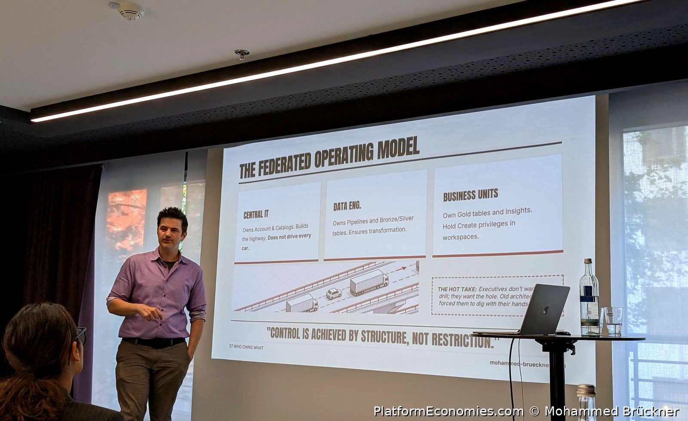
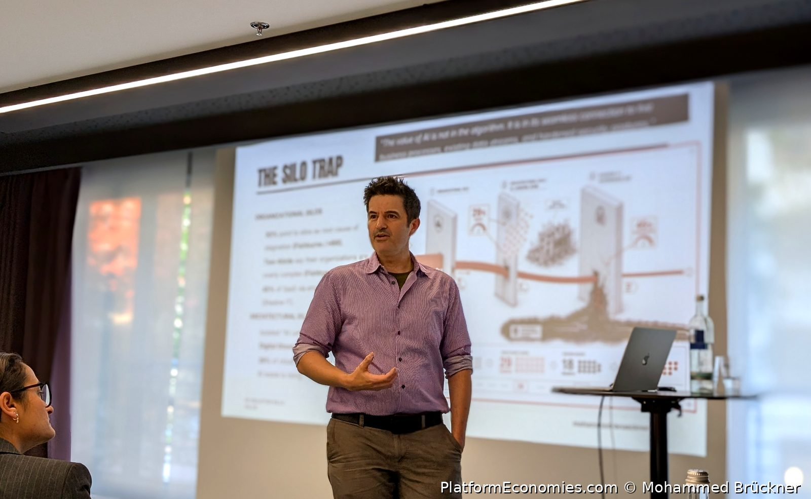
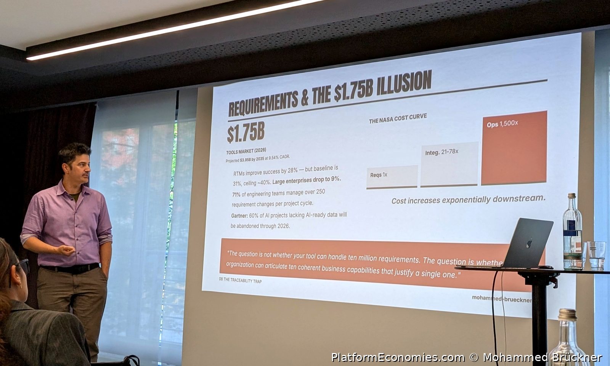

# Speaking & Workshops

I speak and run workshops on the topics I work in every day: **platform economies**, **enterprise AI**, **enterprise architecture**, and what happens to organizations when AI stops being a tool and starts being a structural force. Twenty years in IT strategy and architecture, applied AI and automation since 2019 — on stage that translates into talks with concrete numbers and workshops where people leave with decisions, not just slides.

Much of what I present comes from my book **[Platform Economies](https://mohammed-brueckner.com/platform-economies/)** and the research behind it.

I am based in **Munich** and work in **English and German**.

*On stage at the AI in Product IT Community Workshop, Munich, May 2026.*

---

## What I speak about

- **Platform economies and platform compression** — why the comfortable middle ground of the software industry is disappearing, and the three operating models that remain. The core of my current keynotes, drawn from the book.
- **The Threshold Test** — five questions that separate AI value from AI activity, for executives who fund pilots. Also available as a [self-serve diagnostic](https://mohammed-brueckner.com/threshold-test/).
- **Practical enterprise AI** — from pilots to value: why AI projects die, and what the ones that survive do differently.
- **Architecture as code** — PlantUML, ArchiMate, and why diagrams deserve better than desktop drawing tools. The material behind the most-read pages on this site.
- **Data and AI platforms on Azure** — Databricks, Microsoft Fabric, MLOps: the architecture behind governed, scalable AI.
- **Change management** — why 70% of transformation projects fail, and the Double Trinity Pyramid model for doing better.

---

## Selected talks and appearances

- **AI in Product IT Community Workshop — Munich, May 2026.** I opened the panel discussion on practical AI adoption in product and platform teams, in front of over 50 practitioners. Peer-to-peer, no vendor theater — the real topics: hallucinations, ego-driven adoption, and the people problems that actually decide whether AI succeeds. Materials and slides: [mohammed-brueckner.com/aicommunity](https://mohammed-brueckner.com/aicommunity/).
- **TDWI** — conference talks on data architecture and strategy.
- **Heise Digital** — conference talks for the German tech audience.
- **Microsoft AI Pitch Perfect Contest — winner, June 2023.** Making AI compelling to a skeptical audience, under competitive pressure.
- **Microsoft AI Shorties series** — featured contributor.

---

## Workshops

Talks inform. Workshops change what people do on Monday morning. The formats I run:

- **AI Design Sprints** — rapid, structured innovation workshops that move a concept to a testable prototype in days, not quarters.
- **AI opportunity mapping** — finding the use cases in your organization where AI pays back, and killing the ones that will not.
- **Envisioning and design thinking workshops** — Billboard Design Thinking and envisioning formats for leadership and product teams.

One example, anonymized: an **AI and sustainability envisioning workshop for a global consumer goods group**, run during my time at Microsoft. The goal: discover AI use cases that serve ambitious sustainability targets. Automation and sustainability turned out to reinforce each other — the sessions produced a concrete, ranked list of use cases the teams took into delivery.

---

## Booking

The fastest way to reach me is [LinkedIn](https://www.linkedin.com/in/mbrueckner/).

Tell me the audience, the occasion, and what should be different afterwards. I will tell you honestly whether I am the right person for it — and if I am not, I probably know who is.

---

*Mohammed Brückner is an enterprise architect and author based in Munich. His books include [Platform Economies](https://mohammed-brueckner.com/platform-economies/), [IT's not magic, it's architecture](https://www.amazon.com/-/de/dp/B0CVZ1BWPN), and [MLOps with Databricks on Azure End-To-End](https://www.amazon.com/dp/B0FTSY78DR). He hosts the [Platform Economies podcast](https://open.spotify.com/show/0LUvemwzThUrQR8f5UmFRW).*
